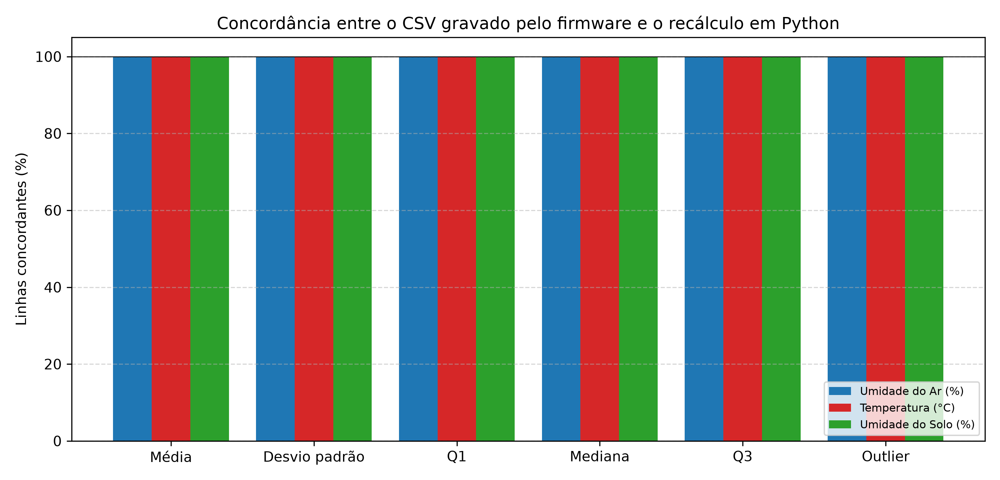
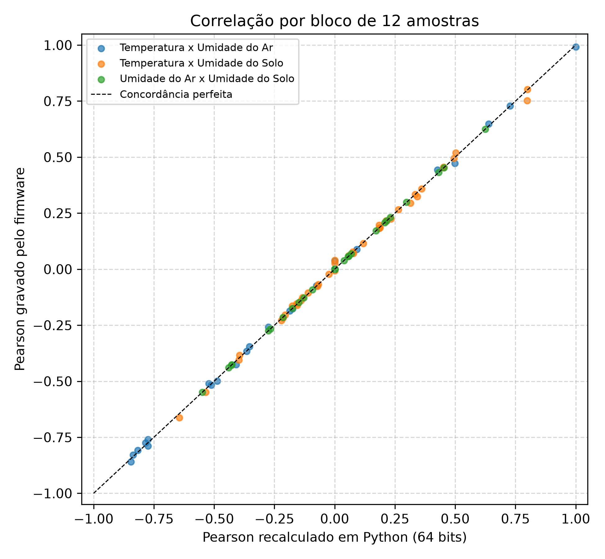
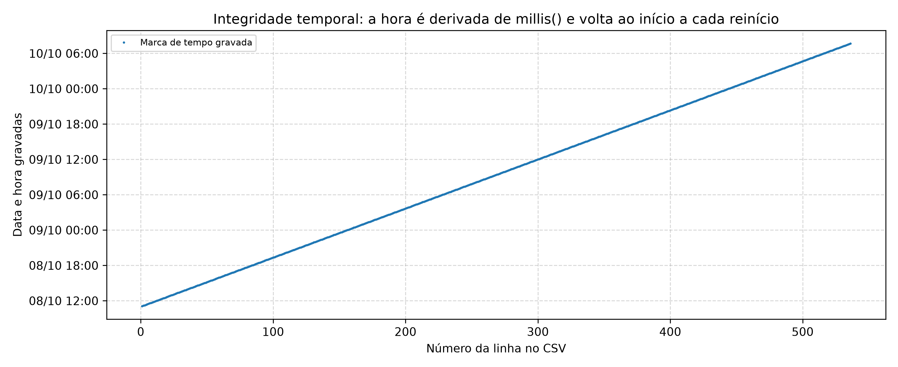

# Relatório: validação do cálculo embarcado

- **Arquivo de origem:** DadosAnalise.CSV
- **Período analisado:** 2025-10-08 11:45:00 a 2025-10-10 07:40:00
- **Registros analisados:** 528 (de 536; descartadas 8 leituras de aquecimento, as 8 primeiras de cada um dos 1 segmento(s) de operação contínua)
- **Reinícios da placa detectados:** 0
- **Intervalo típico entre amostras:** 300 s

## 1. Objetivo e método

A validação verifica se os valores gravados no CSV correspondem ao que o algoritmo do firmware deveria produzir. O Python recalcula cada estatística a partir das **leituras brutas gravadas no próprio CSV**, reproduzindo a aritmética de 32 bits (float) do ATmega328P e, como referência numérica, a aritmética de 64 bits. As características do algoritmo embarcado que foram reproduzidas são:

- **Janela das estatísticas:** buffer circular de 8 amostras, que começa preenchido com zeros e é reiniciado a cada reinício da placa.
- **Leitura atual na janela:** a leitura entra no buffer antes do cálculo, de modo que o critério de outlier é aplicado a uma janela que já contém a própria leitura.
- **Variância:** amostral (divisor n-1), calculada pela fórmula das somas (soma dos quadrados menos n vezes a média ao quadrado).
- **Quartis:** elementos do vetor ordenado nas posições 2 (Q1), 4 (mediana) e 6 (Q3), contadas a partir de zero, sem interpolação. Para janela de tamanho par, a mediana é o elemento superior, e não a média dos dois centrais.
- **Outlier (critério de Tukey):** leitura abaixo de Q1 - 1.5 x IQR ou acima de Q3 + 1.5 x IQR.
- **Pearson:** calculado sobre blocos consecutivos e sem sobreposição de 12 amostras, ao completar cada bloco, e mantido nas linhas seguintes.

## 2. Integridade temporal

A placa não possui relógio de tempo real (RTC): data e hora são calculadas a partir de millis() somado a um horário inicial fixo no código. Em cada reinício, a contagem volta ao horário inicial, o que produz horários repetidos ou retrocessos.

| Indicador | Valor |
|---|---|
| Linhas no arquivo | 536 |
| Reinícios detectados (retrocesso ou repetição de horário) | 0 |
| Segmentos de operação contínua | 1 |
| Horários repetidos | 0 |
| Lacunas maiores que 1,5 vez o intervalo típico | 0 |
| Intervalo típico entre amostras | 300 s |
| Primeira marca de tempo gravada | 2025-10-08 11:05:00 |
| Última marca de tempo gravada | 2025-10-10 07:40:00 |
| Duração com linha do tempo reconstruída | 44.6 h |

Segmentos de operação contínua:

| Segmento | Linhas | Primeira marca | Última marca |
|---|---|---|---|
| 1 | 536 | 2025-10-08 11:05:00 | 2025-10-10 07:40:00 |

## 3. Concordância das estatísticas da janela

Uma linha é considerada concordante quando o valor gravado difere do recalculado em até 0.006 (o firmware grava duas casas decimais). Para o outlier, a marcação deve ser idêntica.

| Variável | Estatística | Linhas concordantes | Erro máximo absoluto | Divergências |
|---|---|---|---|---|
| Umidade do Ar (%) | Média | 100.00% | 0.0050 | 0 |
| Umidade do Ar (%) | Desvio padrão | 100.00% | 0.0048 | 0 |
| Umidade do Ar (%) | Q1 | 100.00% | 0.0000 | 0 |
| Umidade do Ar (%) | Mediana | 100.00% | 0.0000 | 0 |
| Umidade do Ar (%) | Q3 | 100.00% | 0.0000 | 0 |
| Umidade do Ar (%) | Outlier (SIM/NAO) | 100.00% | - | 0 |
| Temperatura (°C) | Média | 100.00% | 0.0050 | 0 |
| Temperatura (°C) | Desvio padrão | 100.00% | 0.0050 | 0 |
| Temperatura (°C) | Q1 | 100.00% | 0.0000 | 0 |
| Temperatura (°C) | Mediana | 100.00% | 0.0000 | 0 |
| Temperatura (°C) | Q3 | 100.00% | 0.0000 | 0 |
| Temperatura (°C) | Outlier (SIM/NAO) | 100.00% | - | 0 |
| Umidade do Solo (%) | Média | 100.00% | 0.0050 | 0 |
| Umidade do Solo (%) | Desvio padrão | 100.00% | 0.0050 | 0 |
| Umidade do Solo (%) | Q1 | 100.00% | 0.0000 | 0 |
| Umidade do Solo (%) | Mediana | 100.00% | 0.0000 | 0 |
| Umidade do Solo (%) | Q3 | 100.00% | 0.0000 | 0 |
| Umidade do Solo (%) | Outlier (SIM/NAO) | 100.00% | - | 0 |

## 4. Erro numérico do desvio padrão (32 bits contra 64 bits)

O firmware calcula a variância pela fórmula das somas em precisão simples. Quando a variância é pequena em relação ao valor médio, o cancelamento numérico pode distorcer o resultado ou até gerar valores negativos, cuja raiz resulta em NaN.

| Variável | Erro médio do desvio | Erro máximo do desvio | Linhas com desvio NaN |
|---|---|---|---|
| Umidade do Ar (%) | 0.0012 | 0.0048 | 0 |
| Temperatura (°C) | 0.0043 | 0.0100 | 75 |
| Umidade do Solo (%) | 0.0031 | 0.0050 | 0 |

## 5. Outliers durante o aquecimento do buffer

Nas primeiras 8 leituras de cada segmento, o buffer ainda contém zeros e as estatísticas não representam a variável medida. Marcações de outlier nesse trecho são artefato do algoritmo, e não anomalias dos sensores.

| Variável | Outliers no arquivo | No aquecimento | Parcela no aquecimento | Outliers após descartar o aquecimento |
|---|---|---|---|---|
| Umidade do Ar (%) | 34 | 1 | 2.9% | 33 |
| Temperatura (°C) | 70 | 1 | 1.4% | 69 |
| Umidade do Solo (%) | 25 | 1 | 4.0% | 24 |

## 6. Correlação de Pearson (blocos de 12 amostras)

O valor gravado em cada bloco é comparado ao recálculo em 32 bits (tolerância de 0.001) e ao recálculo em 64 bits. Também se verifica se o valor é mantido corretamente nas linhas entre dois blocos.

| Par | Blocos | Blocos concordantes (32 bits) | Erro máx. (32 bits) | Erro máx. (64 bits) | Coluna concordante (todas as linhas) | Blocos NaN |
|---|---|---|---|---|---|---|
| Temperatura x Umidade do Ar | 44 | 100.00% | 0.0000 | 0.0377 | 100.00% | 0 |
| Temperatura x Umidade do Solo | 44 | 100.00% | 0.0000 | 0.0471 | 100.00% | 3 |
| Umidade do Ar x Umidade do Solo | 44 | 100.00% | 0.0000 | 0.0000 | 100.00% | 0 |

## 7. Interpretação

- Os valores gravados são compatíveis com o algoritmo descrito: o recálculo independente reproduz todas as estatísticas, os indicadores de outlier e as correlações, sem divergências. Isso também indica que a versão do firmware utilizada na coleta corresponde ao código analisado.
- Não foram detectados reinícios: a operação foi contínua do início ao fim, segundo as marcas de tempo gravadas.
- 3 marcação(ões) de outlier ocorreram durante o aquecimento do buffer e devem ser desconsideradas na interpretação.
- Há 75 valor(es) NaN de desvio padrão, compatível com variância negativa por cancelamento numérico em precisão simples. Convém calcular a variância de forma estável (algoritmo de Welford) em uma versão futura.

## 8. Observações metodológicas

- Os quartis do firmware são obtidos por posição no vetor ordenado, sem interpolação, e a mediana é o elemento de índice N/2. Isso difere de `pandas.quantile` e `numpy.median`, que interpolam. Por esse motivo, o critério de outlier calculado sobre a série inteira no Python não é equivalente ao do firmware.
- As entradas do recálculo são as leituras gravadas com duas casas decimais; pequenas diferenças de arredondamento são cobertas pelas tolerâncias.
- Foram registradas 0 divergência(s).
