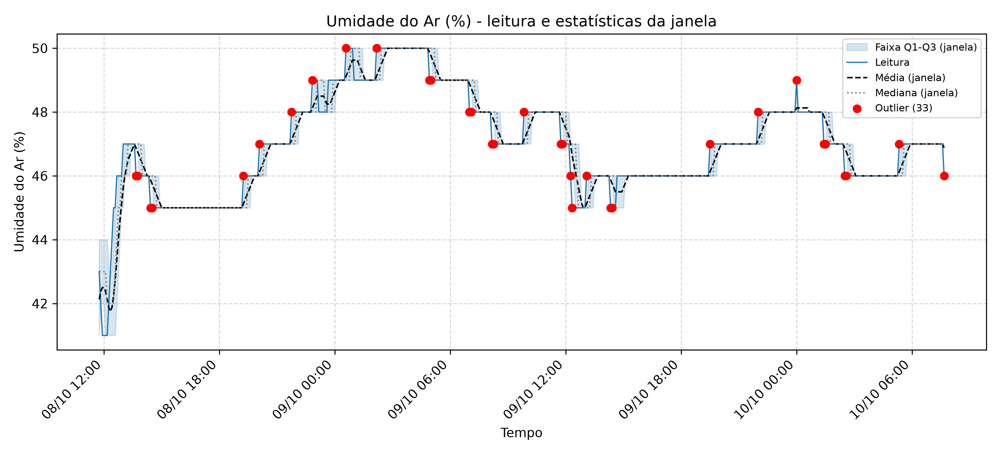
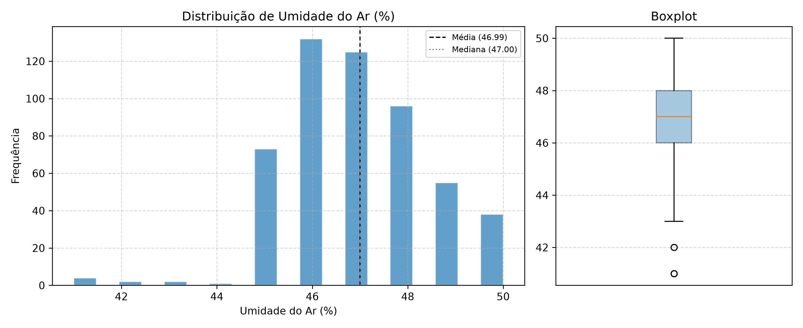

# Relatório: Umidade do Ar (%)

- **Arquivo de origem:** DadosAnalise.CSV
- **Período analisado:** 2025-10-08 11:45:00 a 2025-10-10 07:40:00
- **Registros analisados:** 528 (de 536; descartadas 8 leituras de aquecimento, as 8 primeiras de cada um dos 1 segmento(s) de operação contínua)
- **Reinícios da placa detectados:** 0
- **Intervalo típico entre amostras:** 300 s

## 1. Descrição dos gráficos

O primeiro gráfico apresenta a série temporal de **Umidade do Ar (%)** junto às estatísticas calculadas pelo firmware em janelas deslizantes de 8 amostras: média (tracejada), mediana (pontilhada) e faixa interquartil Q1-Q3 (área sombreada). Leituras sinalizadas como outliers pelo firmware aparecem em vermelho. O segundo gráfico mostra a distribuição de frequências e o boxplot da série completa.

## 2. Estatísticas globais (série completa)

| Métrica | Valor |
|---|---|
| Média | 46.99 |
| Mediana | 47.00 |
| Desvio padrão | 1.58 |
| Variância | 2.50 |
| Coeficiente de variação | 3.4% |
| Mínimo | 41.00 |
| Percentil 5 | 45.00 |
| Q1 (percentil 25) | 46.00 |
| Q3 (percentil 75) | 48.00 |
| Percentil 95 | 50.00 |
| Máximo | 50.00 |
| Amplitude | 9.00 |
| Intervalo interquartil (IQR) | 2.00 |
| Assimetria | -0.193 |
| Curtose (excesso) | 0.785 |
| Valores distintos observados | 10 |
| Menor degrau entre valores distintos | 1.000 |
| Outliers (critério IQR global, quartis interpolados) | 6 |

## 3. Tendência temporal

| Métrica | Valor |
|---|---|
| Inclinação da reta de tendência | 0.0130 por hora |
| Variação estimada no período | +0.57 |
| R² da tendência linear | 0.011 |
| Média do primeiro décimo da série (52 leituras) | 45.04 |
| Média do último décimo da série (52 leituras) | 46.54 |
| Diferença entre último e primeiro décimo | +1.50 |

## 4. Estatísticas do firmware (janela de 8 amostras)

| Métrica | Valor |
|---|---|
| Média das médias de janela | 46.97 |
| Média das medianas de janela | 47.01 |
| Desvio padrão médio da janela | 0.20 |
| Desvio padrão máximo da janela | 1.92 |
| Amplitude interquartil média (Q3-Q1) | 0.28 |
| Outliers marcados pelo firmware (sem aquecimento) | 33 (6.2% das leituras) |
| Outliers em janelas com IQR nulo | 33 (100.0% dos outliers) |

## 5. Outliers detectados pelo firmware

Primeiro outlier em 2025-10-08 13:40:00 e último em 2025-10-10 07:40:00.

| Data e hora | Leitura | Média da janela | Desvio da janela |
|---|---|---|---|
| 2025-10-08 13:40:00 | 46.00 | 46.88 | 0.35 |
| 2025-10-08 13:45:00 | 46.00 | 46.75 | 0.46 |
| 2025-10-08 14:25:00 | 45.00 | 45.88 | 0.35 |
| 2025-10-08 14:30:00 | 45.00 | 45.75 | 0.46 |
| 2025-10-08 19:15:00 | 46.00 | 45.13 | 0.35 |
| 2025-10-08 20:05:00 | 47.00 | 46.13 | 0.35 |
| 2025-10-08 21:45:00 | 48.00 | 47.13 | 0.35 |
| 2025-10-08 22:50:00 | 49.00 | 48.13 | 0.35 |
| 2025-10-09 00:35:00 | 50.00 | 49.13 | 0.35 |
| 2025-10-09 02:10:00 | 50.00 | 49.13 | 0.35 |
| 2025-10-09 04:55:00 | 49.00 | 49.88 | 0.35 |
| 2025-10-09 05:00:00 | 49.00 | 49.75 | 0.46 |
| 2025-10-09 07:00:00 | 48.00 | 48.88 | 0.35 |
| 2025-10-09 07:05:00 | 48.00 | 48.75 | 0.46 |
| 2025-10-09 08:10:00 | 47.00 | 47.88 | 0.35 |
| 2025-10-09 08:15:00 | 47.00 | 47.75 | 0.46 |
| 2025-10-09 09:50:00 | 48.00 | 47.13 | 0.35 |
| 2025-10-09 11:45:00 | 47.00 | 47.88 | 0.35 |
| 2025-10-09 11:50:00 | 47.00 | 47.75 | 0.46 |
| 2025-10-09 12:15:00 | 46.00 | 47.00 | 0.53 |

*Exibidos os 20 primeiros de 33 outliers.*

## 6. Interpretação

- A série apresenta baixa variabilidade relativa (coeficiente de variação de 3.4%).
- A distribuição aproximadamente simétrica (assimetria de -0.19).
- Quanto à tendência, não há tendência linear relevante ao longo do período.
- O firmware sinalizou 33 outlier(s) por janela (6.2% das leituras), enquanto o critério IQR global identificou 6. A diferença decorre de o firmware avaliar cada leitura contra a janela local (com quartis por posição, sem interpolação), e o critério global comparar com toda a série.
- O sensor apresentou 10 valores distintos, com menor degrau de 1.00. Essa resolução discreta deve ser comparada à exatidão do sensor antes de interpretar pequenas variações como fenômeno físico.
- 100% dos outliers ocorreram em janelas com IQR nulo, situação em que qualquer variação da leitura é marcada. Isso indica efeito da resolução discreta do sensor combinada ao critério de Tukey em janela curta, e não necessariamente anomalia.

## 7. Observações metodológicas

- As 8 primeiras leituras de cada segmento de operação contínua foram descartadas, pois o buffer do firmware ainda continha zeros.
- Estatísticas globais foram calculadas no Python; estatísticas de janela foram calculadas e gravadas pelo firmware. A conferência do cálculo embarcado está em `01_validacao_firmware`.
