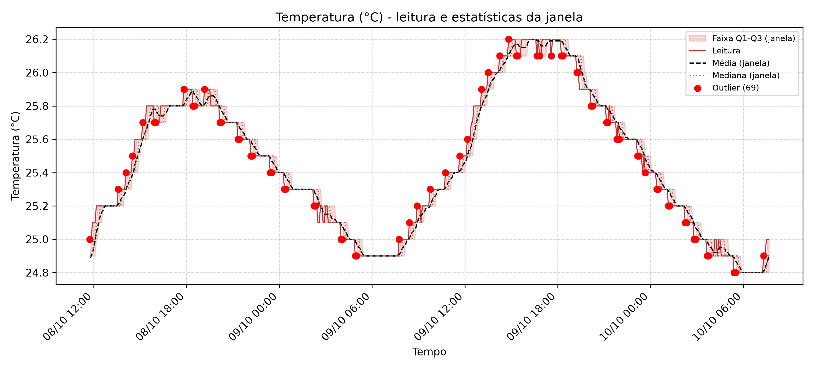
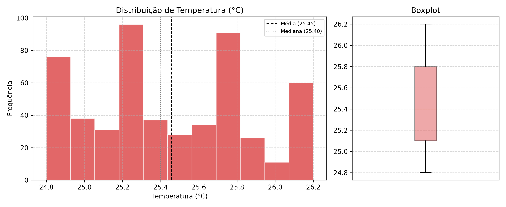

# Relatório: Temperatura (°C)

- **Arquivo de origem:** DadosAnalise.CSV
- **Período analisado:** 2025-10-08 11:45:00 a 2025-10-10 07:40:00
- **Registros analisados:** 528 (de 536; descartadas 8 leituras de aquecimento, as 8 primeiras de cada um dos 1 segmento(s) de operação contínua)
- **Reinícios da placa detectados:** 0
- **Intervalo típico entre amostras:** 300 s

## 1. Descrição dos gráficos

O primeiro gráfico apresenta a série temporal de **Temperatura (°C)** junto às estatísticas calculadas pelo firmware em janelas deslizantes de 8 amostras: média (tracejada), mediana (pontilhada) e faixa interquartil Q1-Q3 (área sombreada). Leituras sinalizadas como outliers pelo firmware aparecem em vermelho. O segundo gráfico mostra a distribuição de frequências e o boxplot da série completa.

## 2. Estatísticas globais (série completa)

| Métrica | Valor |
|---|---|
| Média | 25.45 |
| Mediana | 25.40 |
| Desvio padrão | 0.41 |
| Variância | 0.17 |
| Coeficiente de variação | 1.6% |
| Mínimo | 24.80 |
| Percentil 5 | 24.90 |
| Q1 (percentil 25) | 25.10 |
| Q3 (percentil 75) | 25.80 |
| Percentil 95 | 26.20 |
| Máximo | 26.20 |
| Amplitude | 1.40 |
| Intervalo interquartil (IQR) | 0.70 |
| Assimetria | 0.181 |
| Curtose (excesso) | -1.079 |
| Valores distintos observados | 15 |
| Menor degrau entre valores distintos | 0.100 |
| Outliers (critério IQR global, quartis interpolados) | 0 |

## 3. Tendência temporal

| Métrica | Valor |
|---|---|
| Inclinação da reta de tendência | -0.0045 por hora |
| Variação estimada no período | -0.20 |
| R² da tendência linear | 0.019 |
| Média do primeiro décimo da série (52 leituras) | 25.39 |
| Média do último décimo da série (52 leituras) | 24.88 |
| Diferença entre último e primeiro décimo | -0.52 |

## 4. Estatísticas do firmware (janela de 8 amostras)

| Métrica | Valor |
|---|---|
| Média das médias de janela | 25.45 |
| Média das medianas de janela | 25.46 |
| Desvio padrão médio da janela | 0.04 |
| Desvio padrão máximo da janela | 0.12 |
| Amplitude interquartil média (Q3-Q1) | 0.05 |
| Outliers marcados pelo firmware (sem aquecimento) | 69 (13.1% das leituras) |
| Outliers em janelas com IQR nulo | 69 (100.0% dos outliers) |

## 5. Outliers detectados pelo firmware

Primeiro outlier em 2025-10-08 11:45:00 e último em 2025-10-10 07:20:00.

| Data e hora | Leitura | Média da janela | Desvio da janela |
|---|---|---|---|
| 2025-10-08 11:45:00 | 25.00 | 24.89 | 0.06 |
| 2025-10-08 13:35:00 | 25.30 | 25.21 | 0.04 |
| 2025-10-08 14:05:00 | 25.40 | 25.30 | 0.05 |
| 2025-10-08 14:30:00 | 25.50 | 25.39 | 0.06 |
| 2025-10-08 15:10:00 | 25.70 | 25.60 | 0.05 |
| 2025-10-08 15:55:00 | 25.70 | 25.78 | 0.04 |
| 2025-10-08 16:00:00 | 25.70 | 25.78 | 0.04 |
| 2025-10-08 17:50:00 | 25.90 | 25.81 | 0.03 |
| 2025-10-08 18:25:00 | 25.80 | 25.89 | 0.04 |
| 2025-10-08 18:30:00 | 25.80 | 25.87 | 0.05 |
| 2025-10-08 19:10:00 | 25.90 | 25.81 | 0.03 |
| 2025-10-08 20:10:00 | 25.70 | 25.79 | 0.03 |
| 2025-10-08 20:15:00 | 25.70 | 25.77 | 0.05 |
| 2025-10-08 21:20:00 | 25.60 | 25.69 | 0.04 |
| 2025-10-08 21:25:00 | 25.60 | 25.67 | 0.05 |
| 2025-10-08 22:10:00 | 25.50 | 25.59 | 0.03 |
| 2025-10-08 22:15:00 | 25.50 | 25.57 | 0.05 |
| 2025-10-08 23:25:00 | 25.40 | 25.49 | 0.04 |
| 2025-10-08 23:30:00 | 25.40 | 25.47 | 0.05 |
| 2025-10-09 00:20:00 | 25.30 | 25.39 | 0.04 |

*Exibidos os 20 primeiros de 69 outliers.*

## 6. Interpretação

- A série apresenta baixa variabilidade relativa (coeficiente de variação de 1.6%).
- A distribuição aproximadamente simétrica (assimetria de 0.18).
- Quanto à tendência, não há tendência linear relevante ao longo do período.
- O firmware sinalizou 69 outlier(s) por janela (13.1% das leituras), enquanto o critério IQR global identificou 0. A diferença decorre de o firmware avaliar cada leitura contra a janela local (com quartis por posição, sem interpolação), e o critério global comparar com toda a série.
- O sensor apresentou 15 valores distintos, com menor degrau de 0.10. Essa resolução discreta deve ser comparada à exatidão do sensor antes de interpretar pequenas variações como fenômeno físico.
- 100% dos outliers ocorreram em janelas com IQR nulo, situação em que qualquer variação da leitura é marcada. Isso indica efeito da resolução discreta do sensor combinada ao critério de Tukey em janela curta, e não necessariamente anomalia.

## 7. Observações metodológicas

- As 8 primeiras leituras de cada segmento de operação contínua foram descartadas, pois o buffer do firmware ainda continha zeros.
- Estatísticas globais foram calculadas no Python; estatísticas de janela foram calculadas e gravadas pelo firmware. A conferência do cálculo embarcado está em `01_validacao_firmware`.
