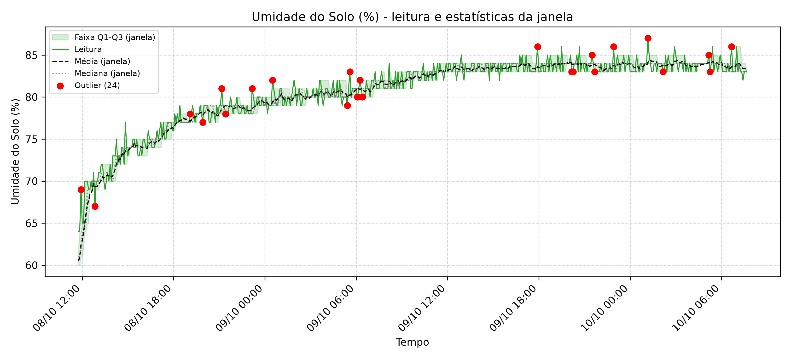
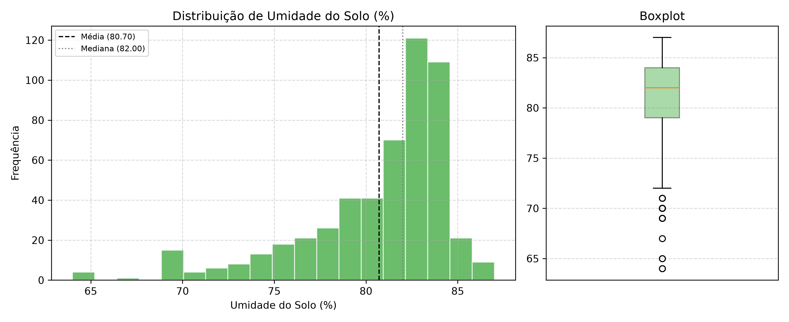

# Relatório: Umidade do Solo (%)

- **Arquivo de origem:** DadosAnalise.CSV
- **Período analisado:** 2025-10-08 11:45:00 a 2025-10-10 07:40:00
- **Registros analisados:** 528 (de 536; descartadas 8 leituras de aquecimento, as 8 primeiras de cada um dos 1 segmento(s) de operação contínua)
- **Reinícios da placa detectados:** 0
- **Intervalo típico entre amostras:** 300 s

## 1. Descrição dos gráficos

O primeiro gráfico apresenta a série temporal de **Umidade do Solo (%)** junto às estatísticas calculadas pelo firmware em janelas deslizantes de 8 amostras: média (tracejada), mediana (pontilhada) e faixa interquartil Q1-Q3 (área sombreada). Leituras sinalizadas como outliers pelo firmware aparecem em vermelho. O segundo gráfico mostra a distribuição de frequências e o boxplot da série completa.

## 2. Estatísticas globais (série completa)

| Métrica | Valor |
|---|---|
| Média | 80.70 |
| Mediana | 82.00 |
| Desvio padrão | 4.05 |
| Variância | 16.40 |
| Coeficiente de variação | 5.0% |
| Mínimo | 64.00 |
| Percentil 5 | 72.00 |
| Q1 (percentil 25) | 79.00 |
| Q3 (percentil 75) | 84.00 |
| Percentil 95 | 85.00 |
| Máximo | 87.00 |
| Amplitude | 23.00 |
| Intervalo interquartil (IQR) | 5.00 |
| Assimetria | -1.472 |
| Curtose (excesso) | 2.089 |
| Valores distintos observados | 22 |
| Menor degrau entre valores distintos | 1.000 |
| Outliers (critério IQR global, quartis interpolados) | 24 |

## 3. Tendência temporal

| Métrica | Valor |
|---|---|
| Inclinação da reta de tendência | 0.2706 por hora |
| Variação estimada no período | +11.88 |
| R² da tendência linear | 0.722 |
| Média do primeiro décimo da série (52 leituras) | 71.42 |
| Média do último décimo da série (52 leituras) | 83.71 |
| Diferença entre último e primeiro décimo | +12.29 |

## 4. Estatísticas do firmware (janela de 8 amostras)

| Métrica | Valor |
|---|---|
| Média das médias de janela | 80.55 |
| Média das medianas de janela | 80.62 |
| Desvio padrão médio da janela | 0.90 |
| Desvio padrão máximo da janela | 3.34 |
| Amplitude interquartil média (Q3-Q1) | 1.22 |
| Outliers marcados pelo firmware (sem aquecimento) | 24 (4.5% das leituras) |
| Outliers em janelas com IQR nulo | 15 (62.5% dos outliers) |

## 5. Outliers detectados pelo firmware

Primeiro outlier em 2025-10-08 11:55:00 e último em 2025-10-10 06:40:00.

| Data e hora | Leitura | Média da janela | Desvio da janela |
|---|---|---|---|
| 2025-10-08 11:55:00 | 69.00 | 62.38 | 3.34 |
| 2025-10-08 12:50:00 | 67.00 | 69.37 | 1.19 |
| 2025-10-08 19:05:00 | 78.00 | 77.12 | 0.35 |
| 2025-10-08 19:55:00 | 77.00 | 77.87 | 0.64 |
| 2025-10-08 21:10:00 | 81.00 | 78.62 | 1.19 |
| 2025-10-08 21:25:00 | 78.00 | 79.00 | 0.93 |
| 2025-10-08 23:10:00 | 81.00 | 78.62 | 1.06 |
| 2025-10-09 00:30:00 | 82.00 | 79.37 | 1.19 |
| 2025-10-09 05:25:00 | 79.00 | 80.00 | 0.93 |
| 2025-10-09 05:35:00 | 83.00 | 80.25 | 1.28 |
| 2025-10-09 06:05:00 | 80.00 | 81.00 | 0.93 |
| 2025-10-09 06:15:00 | 82.00 | 80.87 | 0.64 |
| 2025-10-09 06:25:00 | 80.00 | 80.87 | 0.64 |
| 2025-10-09 17:55:00 | 86.00 | 83.62 | 1.06 |
| 2025-10-09 20:10:00 | 83.00 | 83.87 | 0.64 |
| 2025-10-09 20:15:00 | 83.00 | 83.87 | 0.64 |
| 2025-10-09 21:30:00 | 85.00 | 83.87 | 0.64 |
| 2025-10-09 21:40:00 | 83.00 | 83.87 | 0.64 |
| 2025-10-09 22:55:00 | 86.00 | 83.75 | 1.04 |
| 2025-10-10 01:10:00 | 87.00 | 84.12 | 1.25 |

*Exibidos os 20 primeiros de 24 outliers.*

## 6. Interpretação

- A série apresenta baixa variabilidade relativa (coeficiente de variação de 5.0%).
- A distribuição assimétrica à esquerda (cauda de valores baixos) (assimetria de -1.47).
- Quanto à tendência, há tendência linear crescente (R² = 0.72), com variação estimada de +11.88 no período.
- O firmware sinalizou 24 outlier(s) por janela (4.5% das leituras), enquanto o critério IQR global identificou 24. A diferença decorre de o firmware avaliar cada leitura contra a janela local (com quartis por posição, sem interpolação), e o critério global comparar com toda a série.
- O sensor apresentou 22 valores distintos, com menor degrau de 1.00. Essa resolução discreta deve ser comparada à exatidão do sensor antes de interpretar pequenas variações como fenômeno físico.
- 62% dos outliers ocorreram em janelas com IQR nulo, situação em que qualquer variação da leitura é marcada. Isso indica efeito da resolução discreta do sensor combinada ao critério de Tukey em janela curta, e não necessariamente anomalia.

## 7. Observações metodológicas

- As 8 primeiras leituras de cada segmento de operação contínua foram descartadas, pois o buffer do firmware ainda continha zeros.
- Estatísticas globais foram calculadas no Python; estatísticas de janela foram calculadas e gravadas pelo firmware. A conferência do cálculo embarcado está em `01_validacao_firmware`.
