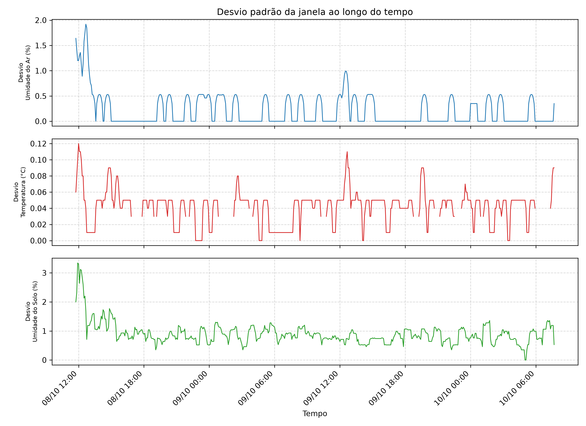

# Relatório: desvio padrão da janela

- **Arquivo de origem:** DadosAnalise.CSV
- **Período analisado:** 2025-10-08 11:45:00 a 2025-10-10 07:40:00
- **Registros analisados:** 528 (de 536; descartadas 8 leituras de aquecimento, as 8 primeiras de cada um dos 1 segmento(s) de operação contínua)
- **Reinícios da placa detectados:** 0
- **Intervalo típico entre amostras:** 300 s

## 1. Descrição do gráfico

O gráfico mostra o desvio padrão amostral calculado pelo firmware em janelas de 8 amostras para cada variável. Valores elevados indicam maior instabilidade das leituras naquele intervalo; valores próximos de zero indicam estabilidade.

## 2. Resumo por variável

| Variável | Média | Mediana | Desvio do desvio | Percentil 95 | Máximo | Instante do máximo |
|---|---|---|---|---|---|---|
| Umidade do Ar (%) | 0.20 | 0.00 | 0.32 | 0.53 | 1.92 | 2025-10-08 12:40:00 |
| Temperatura (°C) | 0.04 | 0.05 | 0.02 | 0.08 | 0.12 | 2025-10-08 12:00:00 |
| Umidade do Solo (%) | 0.90 | 0.83 | 0.37 | 1.41 | 3.34 | 2025-10-08 11:55:00 |

## 3. Estabilidade relativa

O desvio relativo corresponde ao desvio padrão da janela dividido pela média da janela, o que permite comparar variáveis de escalas distintas.

| Variável | Desvio relativo médio | Desvio relativo máximo |
|---|---|---|
| Umidade do Ar (%) | 0.44% | 4.43% |
| Temperatura (°C) | 0.17% | 0.48% |
| Umidade do Solo (%) | 1.13% | 5.35% |

## 4. Interpretação

- Em termos relativos, a variável mais instável nas janelas foi **Umidade do Solo (%)**.
- A variável mais estável foi **Temperatura (°C)**.
