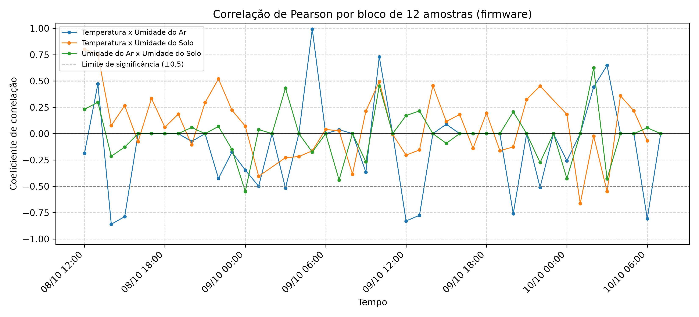

# Relatório: correlação por bloco (firmware)

- **Arquivo de origem:** DadosAnalise.CSV
- **Período analisado:** 2025-10-08 11:45:00 a 2025-10-10 07:40:00
- **Registros analisados:** 528 (de 536; descartadas 8 leituras de aquecimento, as 8 primeiras de cada um dos 1 segmento(s) de operação contínua)
- **Reinícios da placa detectados:** 0
- **Intervalo típico entre amostras:** 300 s

## 1. Descrição do gráfico

O gráfico exibe o coeficiente de correlação de Pearson calculado pelo firmware a cada bloco de 12 amostras consecutivas (sem sobreposição), para cada par de variáveis. As linhas tracejadas indicam o limite de significância adotado (|r| > 0.5). A análise detalhada de cada par está nas pastas `*_par_*`.

## 2. Resumo por par de variáveis

| Par | Blocos | Média | Desvio | Mínimo | Máximo | Último | Blocos com \|r\| > 0.5 | Classificação da média |
|---|---|---|---|---|---|---|---|---|
| Temperatura x Umidade do Ar | 44 | -0.108 | 0.406 | -0.860 | 0.992 | 0.000 | 25.0% | fraca ou desprezível (negativa) |
| Temperatura x Umidade do Solo | 41 | 0.077 | 0.318 | -0.663 | 0.802 | -0.069 | 12.2% | fraca ou desprezível (positiva) |
| Umidade do Ar x Umidade do Solo | 44 | -0.007 | 0.225 | -0.549 | 0.625 | 0.000 | 4.5% | fraca ou desprezível (negativa) |

## 3. Observação

Blocos de 12 amostras produzem coeficientes instáveis. Por isso, a correlação global e a análise por par (com dispersão e correlação defasada) complementam esta visão. A conferência do cálculo do firmware está em `01_validacao_firmware`.
