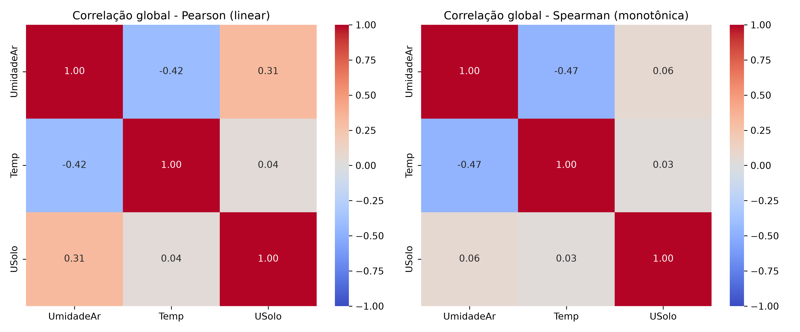

# Relatório: correlação global

- **Arquivo de origem:** DadosAnalise.CSV
- **Período analisado:** 2025-10-08 11:45:00 a 2025-10-10 07:40:00
- **Registros analisados:** 528 (de 536; descartadas 8 leituras de aquecimento, as 8 primeiras de cada um dos 1 segmento(s) de operação contínua)
- **Reinícios da placa detectados:** 0
- **Intervalo típico entre amostras:** 300 s

## 1. Descrição do gráfico

Os mapas de calor apresentam as matrizes de correlação entre as três variáveis, calculadas pelo Python sobre a série completa de leituras brutas (e não por blocos, como no firmware). À esquerda, o coeficiente de Pearson, que mede associação linear; à direita, o de Spearman, que mede associação monotônica e é menos sensível a outliers.

## 2. Matriz de Pearson

|  | Umidade do Ar (%) | Temperatura (°C) | Umidade do Solo (%) |
|---|---|---|---|
| Umidade do Ar (%) | 1.000 | -0.417 | 0.313 |
| Temperatura (°C) | -0.417 | 1.000 | 0.037 |
| Umidade do Solo (%) | 0.313 | 0.037 | 1.000 |

## 3. Matriz de Spearman

|  | Umidade do Ar (%) | Temperatura (°C) | Umidade do Solo (%) |
|---|---|---|---|
| Umidade do Ar (%) | 1.000 | -0.471 | 0.065 |
| Temperatura (°C) | -0.471 | 1.000 | 0.028 |
| Umidade do Solo (%) | 0.065 | 0.028 | 1.000 |

## 4. Interpretação por par

| Par | Pearson | p (Pearson) | Spearman | p (Spearman) | Classificação (Pearson) |
|---|---|---|---|---|---|
| Temperatura (°C) x Umidade do Ar (%) | -0.417 | < 0,001 | -0.471 | < 0,001 | fraca a moderada (negativa) |
| Temperatura (°C) x Umidade do Solo (%) | 0.037 | 0,4012 | 0.028 | 0,5240 | fraca ou desprezível (positiva) |
| Umidade do Ar (%) x Umidade do Solo (%) | 0.313 | < 0,001 | 0.065 | 0,1359 | fraca a moderada (positiva) |

A análise detalhada de cada par (dispersão, regressão e correlação defasada) está nas pastas `*_par_*`.
