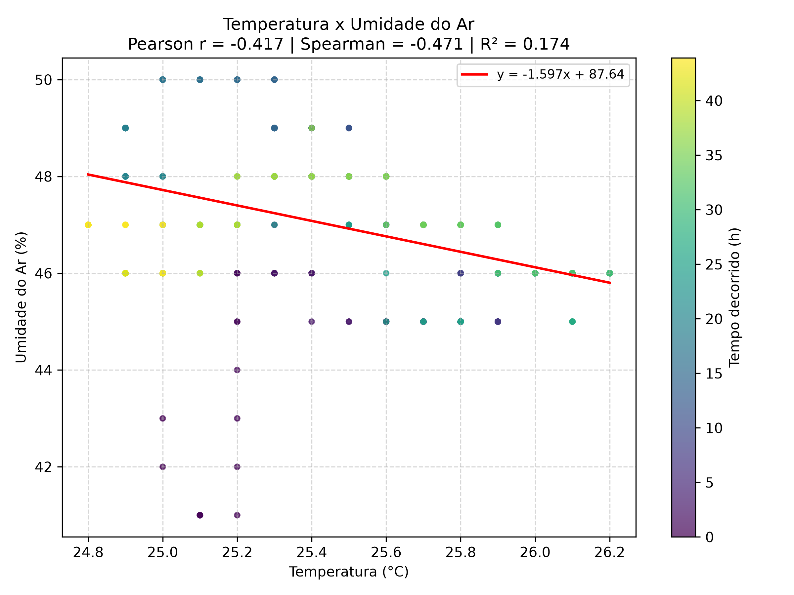
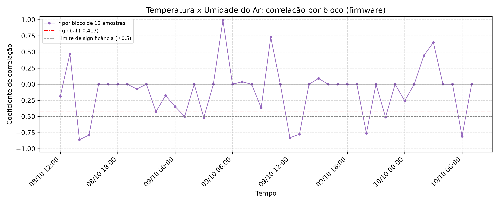
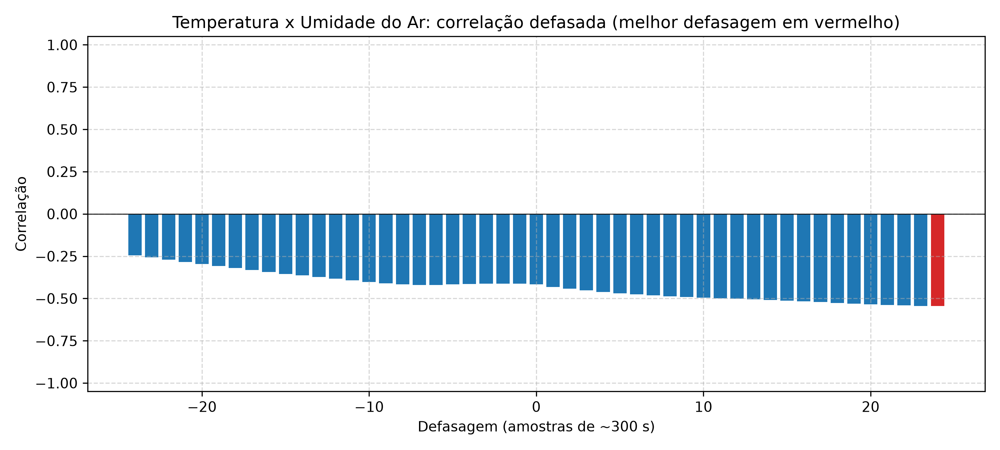

# Relatório do par: Temperatura x Umidade do Ar

- **Arquivo de origem:** DadosAnalise.CSV
- **Período analisado:** 2025-10-08 11:45:00 a 2025-10-10 07:40:00
- **Registros analisados:** 528 (de 536; descartadas 8 leituras de aquecimento, as 8 primeiras de cada um dos 1 segmento(s) de operação contínua)
- **Reinícios da placa detectados:** 0
- **Intervalo típico entre amostras:** 300 s

## 1. Descrição dos gráficos

- **Dispersão:** cada ponto é uma leitura simultânea de Temperatura (°C) (eixo x) e Umidade do Ar (%) (eixo y), colorida pelo tempo decorrido. A reta vermelha é a regressão linear por mínimos quadrados.
- **Blocos do firmware:** evolução do coeficiente de Pearson calculado pelo firmware a cada bloco de 12 amostras, comparado ao coeficiente global.
- **Correlação defasada:** correlação entre Temperatura (°C) e Umidade do Ar (%) deslocada de k amostras. Defasagens positivas comparam a variável x no instante t com a variável y em t+k; revela se uma variável responde à outra com atraso.

## 2. Correlação global

| Medida | Valor |
|---|---|
| Pearson (r) | -0.417 |
| p-valor (Pearson) | < 0,001 |
| Spearman (ρ) | -0.471 |
| p-valor (Spearman) | < 0,001 |
| Coeficiente de determinação (R²) | 0.174 |
| Classificação (Pearson) | fraca a moderada (negativa) |
| Observações pareadas | 528 |

## 3. Regressão linear simples

Modelo ajustado: **Umidade do Ar (%) = -1.5969 × (Temperatura (°C)) + 87.641**

| Parâmetro | Valor |
|---|---|
| Inclinação (coeficiente angular) | -1.5969 |
| Intercepto | 87.641 |
| R² | 0.174 |

Para cada aumento de 1 unidade em Temperatura (°C), o modelo estima uma variação de -1.597 em Umidade do Ar (%). O modelo explica 17.4% da variabilidade de Umidade do Ar (%).

## 4. Correlação por bloco do firmware (blocos de 12 amostras)

| Métrica | Valor |
|---|---|
| Número de blocos | 44 |
| Média dos coeficientes | -0.108 |
| Mediana dos coeficientes | 0.000 |
| Desvio padrão dos coeficientes | 0.406 |
| Mínimo | -0.860 |
| Máximo | 0.992 |
| Último bloco | 0.000 |
| Blocos com r > 0.5 | 6.8% |
| Blocos com r < -0.5 | 18.2% |
| Blocos com \|r\| > 0.5 | 25.0% |
| Inversões de sinal entre blocos consecutivos | 3 |

## 5. Correlação defasada

| Defasagem (amostras) | Tempo aproximado | Correlação |
|---|---|---|
| -24 | -7200 s | -0.245 |
| -12 | -3600 s | -0.383 |
| -1 | -300 s | -0.413 |
| 0 | 0 s | -0.417 |
| 1 | 300 s | -0.432 |
| 12 | 3600 s | -0.502 |
| 24 | 7200 s | -0.545 |

A maior correlação absoluta ocorre na defasagem de **24** amostra(s) (~7200 s), com r = -0.545.

## 6. Interpretação

- A correlação global entre Temperatura (°C) e Umidade do Ar (%) é fraca a moderada (negativa), com r = -0.417.
- O teste de Pearson rejeita a hipótese de correlação nula ao nível de 0.05 (p < 0,001). Com séries longas e autocorrelacionadas, porém, o p-valor tende a ser otimista; convém avaliar também a magnitude.
- Apenas 25.0% dos blocos atingem |r| > 0.5, o que indica relação instável em escala curta.
- A correlação aumenta com defasagem de 24 amostra(s), sugerindo resposta com atraso entre as variáveis.
- Correlação não implica causalidade: variáveis ambientais podem variar em conjunto por influência de um terceiro fator, como o ciclo diário.
