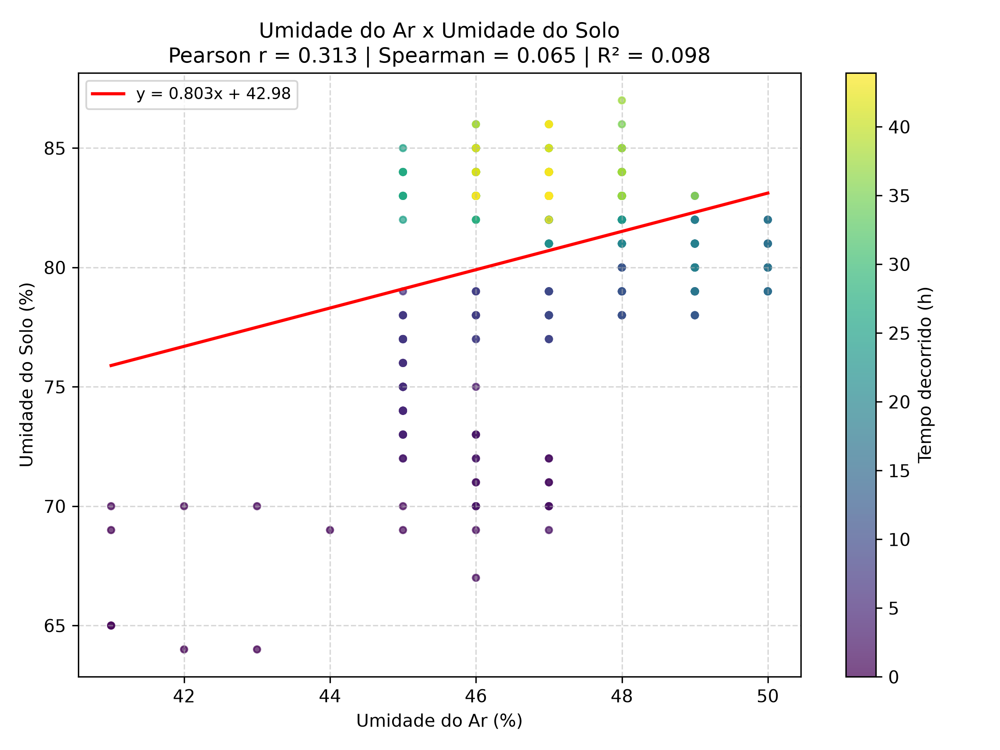
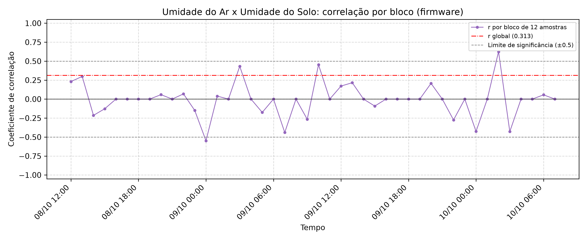
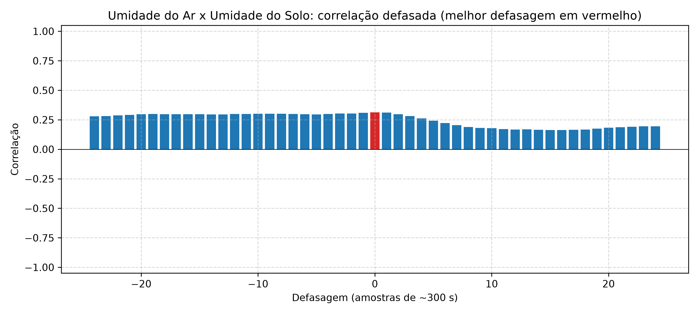

# Relatório do par: Umidade do Ar x Umidade do Solo

- **Arquivo de origem:** DadosAnalise.CSV
- **Período analisado:** 2025-10-08 11:45:00 a 2025-10-10 07:40:00
- **Registros analisados:** 528 (de 536; descartadas 8 leituras de aquecimento, as 8 primeiras de cada um dos 1 segmento(s) de operação contínua)
- **Reinícios da placa detectados:** 0
- **Intervalo típico entre amostras:** 300 s

## 1. Descrição dos gráficos

- **Dispersão:** cada ponto é uma leitura simultânea de Umidade do Ar (%) (eixo x) e Umidade do Solo (%) (eixo y), colorida pelo tempo decorrido. A reta vermelha é a regressão linear por mínimos quadrados.
- **Blocos do firmware:** evolução do coeficiente de Pearson calculado pelo firmware a cada bloco de 12 amostras, comparado ao coeficiente global.
- **Correlação defasada:** correlação entre Umidade do Ar (%) e Umidade do Solo (%) deslocada de k amostras. Defasagens positivas comparam a variável x no instante t com a variável y em t+k; revela se uma variável responde à outra com atraso.

## 2. Correlação global

| Medida | Valor |
|---|---|
| Pearson (r) | 0.313 |
| p-valor (Pearson) | < 0,001 |
| Spearman (ρ) | 0.065 |
| p-valor (Spearman) | 0,1359 |
| Coeficiente de determinação (R²) | 0.098 |
| Classificação (Pearson) | fraca a moderada (positiva) |
| Observações pareadas | 528 |

## 3. Regressão linear simples

Modelo ajustado: **Umidade do Solo (%) = 0.8027 × (Umidade do Ar (%)) + 42.983**

| Parâmetro | Valor |
|---|---|
| Inclinação (coeficiente angular) | 0.8027 |
| Intercepto | 42.983 |
| R² | 0.098 |

Para cada aumento de 1 unidade em Umidade do Ar (%), o modelo estima uma variação de +0.803 em Umidade do Solo (%). O modelo explica 9.8% da variabilidade de Umidade do Solo (%).

## 4. Correlação por bloco do firmware (blocos de 12 amostras)

| Métrica | Valor |
|---|---|
| Número de blocos | 44 |
| Média dos coeficientes | -0.007 |
| Mediana dos coeficientes | 0.000 |
| Desvio padrão dos coeficientes | 0.225 |
| Mínimo | -0.549 |
| Máximo | 0.625 |
| Último bloco | 0.000 |
| Blocos com r > 0.5 | 2.3% |
| Blocos com r < -0.5 | 2.3% |
| Blocos com \|r\| > 0.5 | 4.5% |
| Inversões de sinal entre blocos consecutivos | 5 |

## 5. Correlação defasada

| Defasagem (amostras) | Tempo aproximado | Correlação |
|---|---|---|
| -24 | -7200 s | 0.278 |
| -12 | -3600 s | 0.298 |
| -1 | -300 s | 0.309 |
| 0 | 0 s | 0.313 |
| 1 | 300 s | 0.310 |
| 12 | 3600 s | 0.167 |
| 24 | 7200 s | 0.194 |

A maior correlação absoluta ocorre na defasagem de **0** amostra(s) (~0 s), com r = 0.313.

## 6. Interpretação

- A correlação global entre Umidade do Ar (%) e Umidade do Solo (%) é fraca a moderada (positiva), com r = 0.313.
- O teste de Pearson rejeita a hipótese de correlação nula ao nível de 0.05 (p < 0,001). Com séries longas e autocorrelacionadas, porém, o p-valor tende a ser otimista; convém avaliar também a magnitude.
- Apenas 4.5% dos blocos atingem |r| > 0.5, o que indica relação instável em escala curta.
- Correlação não implica causalidade: variáveis ambientais podem variar em conjunto por influência de um terceiro fator, como o ciclo diário.
