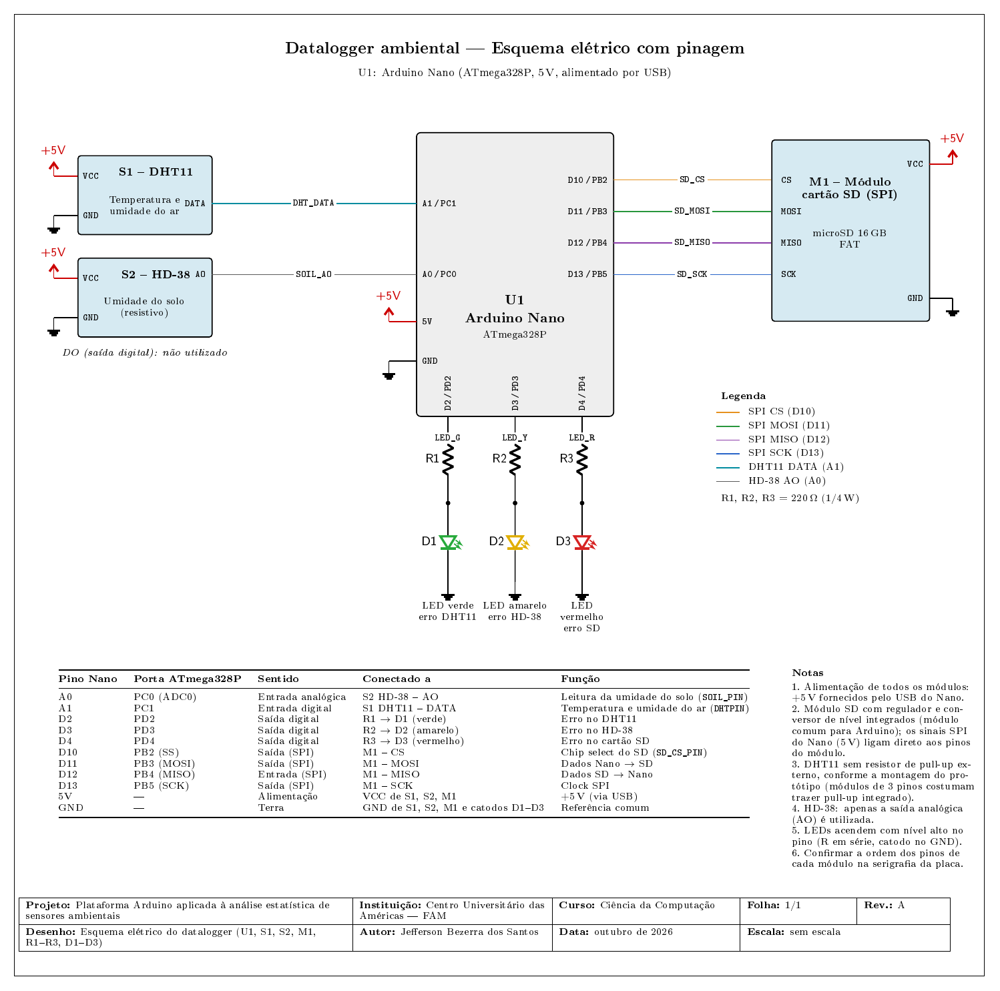

# Estatística Embarcada

**Plataforma Arduino aplicada à análise estatística de sensores ambientais: coleta, processamento e detecção de outliers em sistemas embarcados.**

Protótipo de baixo custo, baseado no Arduino Nano (ATmega328P), que lê temperatura e umidade do ar (DHT11) e umidade do solo (HD-38), calcula estatísticas descritivas, detecta outliers pelo critério de Tukey e estima a correlação de Pearson **diretamente no microcontrolador**, gravando os resultados em cartão SD no formato CSV.

O sistema é um **datalogger embarcado com processamento na borda**. Não possui conectividade de rede e, portanto, não é um dispositivo de Internet das Coisas (IoT).

Este repositório reúne o firmware, o esquema elétrico, os dados brutos da coleta e o script de análise usados no Trabalho de Conclusão de Curso de Ciência da Computação (Centro Universitário das Américas, FAM, 2026).



## Sumário

1. [Visão geral](#visão-geral)
2. [Estrutura do repositório](#estrutura-do-repositório)
3. [Hardware](#hardware)
4. [Firmware](#firmware)
5. [Dados](#dados)
6. [Análise e reprodução dos resultados](#análise-e-reprodução-dos-resultados)
7. [Principais resultados](#principais-resultados)
8. [Limitações conhecidas](#limitações-conhecidas)
9. [Como citar](#como-citar)
10. [Licença](#licença)

## Visão geral

A cada 5 minutos, o firmware:

1. lê o DHT11 (temperatura e umidade do ar) e o HD-38 (umidade do solo);
2. verifica falhas de leitura e sinaliza por LED (ciclos com falha são descartados);
3. atualiza um buffer circular de **8 amostras** por variável;
4. calcula média, mediana, variância, desvio padrão, quartis e IQR sobre a janela;
5. sinaliza como outlier a leitura que viola os limites de Tukey (fator 1,5), sem descartá-la;
6. calcula o coeficiente de correlação de Pearson entre cada par de variáveis a cada **bloco de 12 amostras** (uma hora), sem sobreposição;
7. exibe os valores pela interface Serial, para visualização e depuração;
8. grava o registro em `dados.csv` no cartão SD.

O tamanho reduzido da janela e dos blocos decorre da memória do ATmega328P (2 KB de SRAM), que não comporta o armazenamento da série completa.

## Estrutura do repositório

```
EstatisticaEmbarcada/
├── README.md
├── firmware/
│   └── datalogger_estatistico/     Sketch do Arduino (.ino) e arquivos do Arduino CLI
├── Hardware/
│   ├── EsquemaEletrico/            Esquema elétrico com pinagem (.tex, .pdf, .png)
│   ├── Fotos/                      Fotos do protótipo montado
│   └── MemoriaNano/                Relatório de uso de memória do Arduino Nano
├── Dados/
│   ├── coleta_2025-10-08_a_2025-10-10/
│   │   └── DADOS.CSV               Dados brutos da coleta (cartão SD)
│   └── Analise/
│       ├── analiseDados.py         Script de análise em Python
│       └── resultados/             Gráficos e relatórios gerados pelo script
└── MeuTcc/                         Documentos do trabalho acadêmico
```

## Hardware

### Componentes

| Item | Função |
|---|---|
| Arduino Nano (ATmega328P) | Microcontrolador |
| Sensor DHT11 | Temperatura e umidade relativa do ar |
| Sensor HD-38 (resistivo) | Umidade do solo |
| Módulo para cartão SD (SPI) com microSD de 16 GB | Armazenamento dos registros |
| 3 LEDs de 5 mm (verde, amarelo, vermelho) e 3 resistores de 220 Ω | Sinalização de falhas |
| Protoboard de 400 pontos e jumpers | Montagem |

O custo de aquisição dos componentes foi de **R$ 192,41** (anúncios do Mercado Livre consultados em 10/10/2026), valor que inclui kits vendidos com quantidade superior à utilizada.

### Pinagem

| Pino do Nano | Conectado a | Função |
|---|---|---|
| A0 | HD-38 (saída analógica AO) | Leitura da umidade do solo |
| A1 | DHT11 (DATA) | Temperatura e umidade do ar |
| D2 | LED verde (resistor de 220 Ω) | Erro no DHT11 |
| D3 | LED amarelo (resistor de 220 Ω) | Erro no HD-38 |
| D4 | LED vermelho (resistor de 220 Ω) | Erro no cartão SD |
| D10 | Módulo SD (CS) | Seleção do cartão (chip select) |
| D11 | Módulo SD (MOSI) | Dados do Nano para o cartão |
| D12 | Módulo SD (MISO) | Dados do cartão para o Nano |
| D13 | Módulo SD (SCK) | Clock SPI |
| 5V e GND | Todos os módulos | Alimentação (via USB) e referência comum |

O esquema completo está em `Hardware/EsquemaEletrico/`. A saída digital (DO) do HD-38 não é utilizada.

## Firmware

### Requisitos

- [Arduino CLI](https://arduino.github.io/arduino-cli/) (ou Arduino IDE);
- núcleo `arduino:avr`;
- biblioteca **DHT sensor library** (Adafruit) e sua dependência **Adafruit Unified Sensor**;
- bibliotecas `SD` e `SPI`, já incluídas no núcleo `arduino:avr`.

### Instalação das dependências

```bash
arduino-cli core update-index
arduino-cli core install arduino:avr
arduino-cli lib install "DHT sensor library" "Adafruit Unified Sensor"
```

### Configuração antes de gravar

No início de `datalogger_estatistico.ino`, confira os parâmetros:

| Constante | Valor usado na coleta | Significado |
|---|---|---|
| `LOG_INTERVAL` | `300000` | Intervalo entre leituras, em milissegundos (5 minutos) |
| `SAMPLE_SIZE` | `8` | Tamanho da janela deslizante |
| `CORR_BUFFER_SIZE` | `12` | Tamanho do bloco de correlação |
| `IQR_FACTOR` | `1.5` | Fator do critério de Tukey |
| `SOIL_DRY_VALUE` / `SOIL_WET_VALUE` | `1023` / `300` | Limites do HD-38 (sem calibração) |
| `REFERENCE_YEAR`, `REFERENCE_MONTH`, `REFERENCE_DAY`, `START_HOUR`, `START_MINUTE` | `2025`, `10`, `08`, `11`, `00` | Data e hora de início, somadas ao contador `millis()` |

Como o protótipo **não possui relógio de tempo real (RTC)**, a data e a hora dos registros são calculadas a partir de `millis()` somado ao horário inicial configurado nessas constantes. Os horários são aproximados e se perdem em caso de reinício da placa.

### Compilação e gravação

```bash
arduino-cli compile --fqbn arduino:avr:nano firmware/datalogger_estatistico
arduino-cli upload -p /dev/ttyUSB0 --fqbn arduino:avr:nano firmware/datalogger_estatistico
```

Se a gravação falhar, o Nano pode ter o bootloader antigo. Nesse caso, use `--fqbn arduino:avr:nano:cpu=atmega328old`. A porta serial varia conforme o sistema (`/dev/ttyUSB0` no Linux, `COM3` no Windows e assim por diante).

### Uso de memória

O relatório de compilação informou 21.468 bytes de memória de programa (69%) e 1.221 bytes de memória dinâmica para variáveis globais (59%), restando 827 bytes para variáveis locais e pilha. O arquivo `Hardware/MemoriaNano/memoria.txt` traz o relatório. Esses valores correspondem à alocação estática; o pico de uso em execução não foi medido.

### Sinalização e saída Serial

| LED | Pino | Indica |
|---|---|---|
| Verde | D2 | Falha na leitura do DHT11 (valor indefinido) |
| Amarelo | D3 | Falha na leitura do HD-38 (valor bruto fora da faixa 300 a 1023) |
| Vermelho | D4 | Falha na inicialização do cartão SD |

A interface Serial (9600 bps) exibe, a cada ciclo válido, os valores lidos, as estatísticas calculadas e a indicação de outlier de cada variável. Seu uso é voltado à visualização e à depuração, com o protótipo conectado a um computador.

## Dados

O arquivo `Dados/coleta_2025-10-08_a_2025-10-10/DADOS.CSV` contém os registros brutos da coleta, exatamente como gravados no cartão SD.

| Item | Valor |
|---|---|
| Período | 08/10/2025 às 11h45 até 10/10/2025 às 07h40 (cerca de 44 horas) |
| Intervalo entre registros | 5 minutos |
| Registros | 536 (528 analisados, após o descarte das oito leituras iniciais, afetadas pelo preenchimento do buffer com zeros) |
| Cenário | Ensaio controlado, em câmara de análise de solo |
| Reinícios da placa | Nenhum identificado |

### Colunas do CSV

Para cada variável, as colunas seguem a ordem: valor lido, média, desvio padrão, Q1, mediana, Q3 e indicador de outlier (`SIM` ou `NAO`).

| Grupo | Colunas |
|---|---|
| Tempo | `Data`, `Hora` |
| Umidade do ar | `UmidadeAr`, `MedUAr` (média), `DesvUAr`, `Q1UAr`, `MedUAr` (mediana), `Q3UAr`, `OutUAr` |
| Temperatura | `Temp`, `MedT` (média), `DesvT`, `Q1T`, `MedT` (mediana), `Q3T`, `OutT` |
| Umidade do solo | `USolo`, `MedUS` (média), `DesvUS`, `Q1US`, `MedUS` (mediana), `Q3US`, `OutUS` |
| Correlação (por bloco de 12) | `Corr1` (temperatura × umidade do ar), `Corr2` (temperatura × umidade do solo), `Corr3` (umidade do ar × umidade do solo) |

**Atenção:** o cabeçalho gravado pelo firmware repete os nomes `MedUAr`, `MedT` e `MedUS`, usados tanto para a média quanto para a mediana. A ordem das colunas acima resolve a ambiguidade. Ao ler o arquivo com o Pandas, as colunas repetidas são renomeadas automaticamente (por exemplo, `MedUAr.1`).

O coeficiente de correlação é recalculado ao fechar cada bloco e repetido nos registros seguintes até o fechamento do bloco seguinte. Quando o denominador é nulo (uma das variáveis constante no bloco), o firmware registra zero. Esse zero indica ausência de variação, e não ausência de correlação.

A umidade do solo é um **índice relativo** entre 0 e 100, obtido com os limites 300 e 1023 sem calibração, e não a umidade volumétrica real do solo.

## Análise e reprodução dos resultados

O script `Dados/Analise/analiseDados.py` recalcula as estatísticas a partir das leituras brutas, compara-as com os valores gravados pelo firmware e gera os gráficos e relatórios do trabalho.

### Requisitos

- Python 3.10 ou superior;
- `pandas`, `numpy`, `matplotlib` e `scipy`.

```bash
python -m venv .venv
source .venv/bin/activate        # no Windows: .venv\Scripts\activate
pip install pandas numpy matplotlib scipy
```

### Execução

```bash
python Dados/Analise/analiseDados.py
```

As saídas são gravadas em `Dados/Analise/resultados/`:

| Pasta | Conteúdo |
|---|---|
| `01_validacao_firmware` | Concordância entre o CSV do firmware e o recálculo em Python, correlação firmware versus Python, integridade temporal |
| `02_UmidadeAr_estatisticas`, `03_Temp_estatisticas`, `04_USolo_estatisticas` | Série com estatísticas de janela, distribuição e boxplot de cada variável |
| `05_desvio_padrao` | Desvio padrão das janelas de oito amostras |
| `06_correlacao_firmware` | Correlação de Pearson por bloco, calculada pelo firmware |
| `07_correlacao_global` | Correlação de Pearson e de Spearman sobre a série completa |
| `08_par_Temp_x_UmidadeAr`, `09_par_Temp_x_USolo`, `10_par_UmidadeAr_x_USolo` | Análise detalhada de cada par de variáveis |
| `relatorio_geral.md` | Resumo consolidado |

O recálculo reproduz as características do algoritmo embarcado: buffer circular de oito amostras iniciado com zeros, variância amostral (divisor n-1) pela fórmula das somas, quartis por posição no vetor ordenado (índices 2, 4 e 6, sem interpolação), critério de Tukey com fator 1,5 aplicado a uma janela que já contém a leitura atual e Pearson em blocos consecutivos de 12 amostras.

## Principais resultados

| Aspecto | Resultado |
|---|---|
| Concordância entre CSV do firmware e recálculo em Python | 100% nas três variáveis (média, desvio padrão, Q1, mediana, Q3 e outlier), com erro máximo de 0,005 na média e 0,0048 no desvio |
| Outliers sinalizados pelo firmware (umidade do ar, temperatura, umidade do solo) | 33, 69 e 24 leituras |
| Outliers pelo mesmo critério aplicado à série completa | 6, 0 e 24 leituras |
| Causa da divergência nos outliers | Janelas curtas com IQR nulo sobre leituras de resolução discreta (100% dos casos de umidade do ar e de temperatura) |
| Pearson global (temperatura × umidade do ar, temperatura × solo, umidade do ar × solo) | -0,417, 0,037 e 0,313 |
| Média do Pearson por bloco calculado pelo firmware | -0,108, 0,077 e -0,007 |
| Desvios padrão indefinidos (NaN) na temperatura | 75 (14,0%), por cancelamento numérico em precisão simples |

**Conclusão do trabalho:** o processamento estatístico embarcado é viável em hardware de baixo custo para medidas de tendência central e de dispersão, mas o critério de Tukey em janelas curtas superestima anomalias em séries estáveis e discretizadas, e a correlação por bloco descreve a covariação local, não a relação de longo prazo.

## Limitações conhecidas

- **Sem relógio de tempo real (RTC):** a data e a hora vêm de `millis()` e são aproximadas.
- **HD-38 sem calibração:** a umidade do solo é um índice relativo.
- **Exatidão do DHT11:** ±2 °C e ±5% de umidade relativa, conforme a folha de dados. As variações observadas na temperatura e na umidade do ar estão dentro dessa incerteza.
- **Período curto:** cerca de 44 horas, em câmara fechada, com um sensor por variável e sem instrumento de referência.
- **Resolução discreta:** degrau de 0,1 °C na temperatura e de 1 ponto percentual nas umidades, o que condiciona os métodos baseados em quartis.
- **Precisão simples:** a variância pela fórmula das somas em ponto flutuante de 32 bits pode sofrer cancelamento numérico.
- **Sem conectividade:** os dados só ficam disponíveis após a retirada do cartão SD.

## Como citar

SANTOS, Jefferson Bezerra dos. **Plataforma Arduino aplicada à análise estatística de sensores ambientais: coleta, processamento e detecção de outliers em sistemas embarcados.** 2026. Trabalho de Conclusão de Curso (Graduação em Ciência da Computação) - Centro Universitário das Américas, Arcoverde, 2026.

Repositório: https://github.com/Jeffreypir/EstatisticaEmbarcada

## Licença

O código-fonte (firmware e script de análise) é distribuído sob a licença MIT. Consulte o arquivo `LICENSE`.
